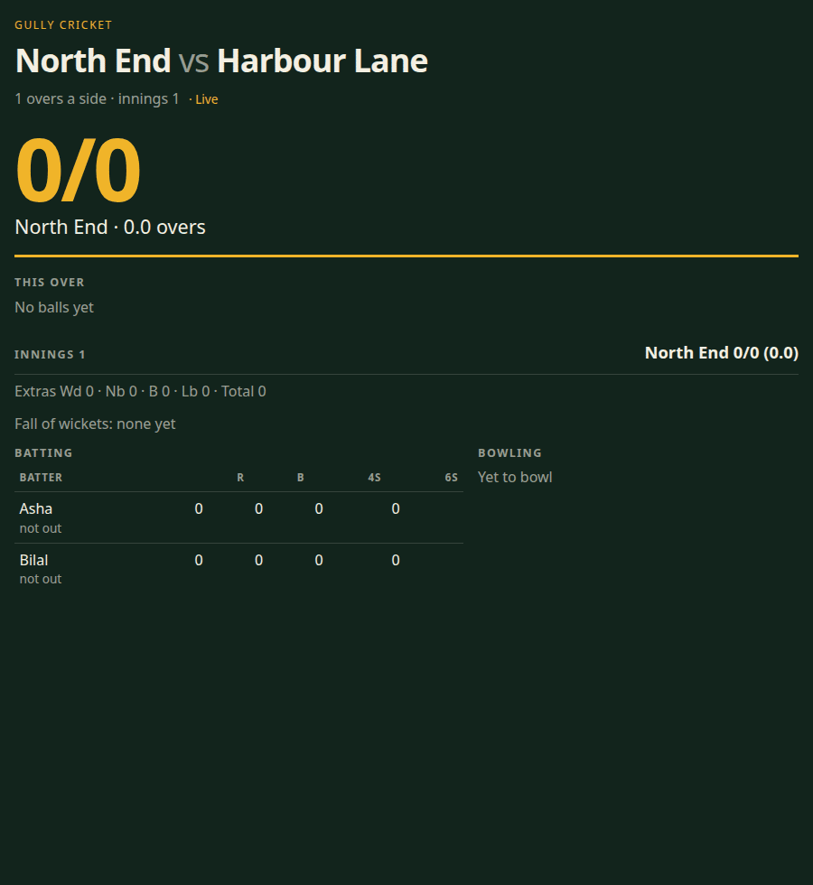
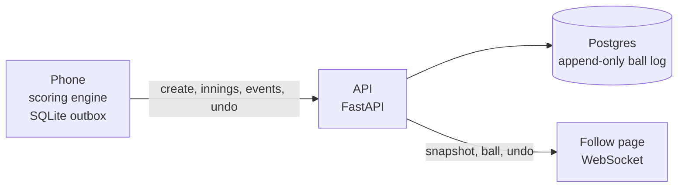

# Gully Cricket Live

A phone scorer for a tape-ball match in a Karachi lane. The scorer taps the ball, the phone keeps the book if the data drops, and anyone with the link can watch the same score update. v1 is the scoring engine, the offline outbox, and the public follow page. There are no accounts.

Abdullah, a 2025 software engineering graduate in Karachi, built this as a portfolio project: one ruleset, shared by the Expo app and the API, proven with the same fixtures.



The clip is a real follow page (`/follow/{slug}`) served by the API. The browser stayed open while balls were posted. The score moves from `0/0` through `wd`, `nb`, and `W`, Harbour Lane chases 3, wins by 1 wicket, and undo puts the chase back to `0/0`.

## Run it

You need Docker, Node 22, and Python 3.12 with [uv](https://docs.astral.sh/uv/).

From the repo root, the API and Postgres come up together. The API waits until Postgres accepts connections, applies migrations, then listens.

```bash
docker compose up --build
```

```bash
curl http://127.0.0.1:8000/healthz
```

The response body is `{"ok":true}`.

Stop the stack with `docker compose down`.

The Expo app lives in `mobile/`. Point it at the API, then start it:

```bash
cd mobile
npm install
```

```powershell
$env:EXPO_PUBLIC_API_URL = "http://127.0.0.1:8000"
npx expo start
```

On bash or zsh, the same variable is `EXPO_PUBLIC_API_URL=http://127.0.0.1:8000 npx expo start`. If the variable is unset, the app uses `http://127.0.0.1:8000`. After the server acknowledges the match, the follow link is `{API_URL}/follow/{slug}`.

A phone on the same Wi-Fi cannot use `127.0.0.1`. Set `EXPO_PUBLIC_API_URL` to the computer's LAN address, and publish port 8000.

## Tests

API checks need Docker. Pytest starts a Postgres 16 container.

```bash
cd api
uv sync --frozen --all-groups
uv run ruff check .
uv run mypy
uv run pytest
```

```bash
cd mobile
npm ci
npx eslint .
npx tsc --noEmit
npx jest --watchman=false
```

`mobile/maestro/` is written for a simulator. It is not part of `npm test`.

GitHub Actions (`.github/workflows/ci.yml`) runs those checks on push and pull request, and builds `api/Dockerfile`.

## Architecture



The phone is the scorer. SQLite holds the match and an ordered outbox. The API is the sync target and the public read side. Postgres stores the ball log. The follow page renders the score and then listens on `/ws/matches/{slug}` for a snapshot, each new ball, and undo.

## Design decisions

The ball log is append-only. Totals, cards, and the result are replayed from the non-voided rows. Nothing treats a stored total as the source of truth.

There is one scoring engine. The phone and the API both implement `contracts/RULES.md` and the same fixtures. A wide, a no-ball, a wicket, and a chase are the same numbers on both sides.

Undo voids the latest non-voided ball. It does not delete the row, and it does not free the `seq` or the `client_uuid`. The state is replayed.

Offline sync is `client_uuid` plus `seq`. The outbox sends create, then innings, then events, in order. Posting the same `client_uuid` again is idempotent: the score does not move, and a different delivery for that uuid is a conflict.

## v2

Not in this version:

- Accounts and a social graph
- Tournaments
- Career stats
- Commentary
